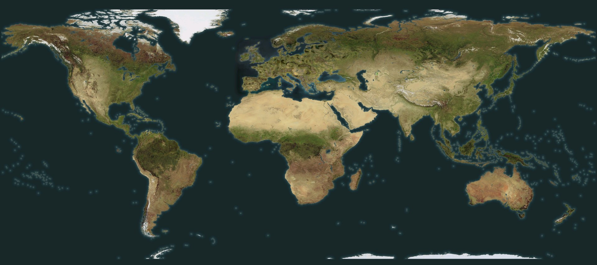
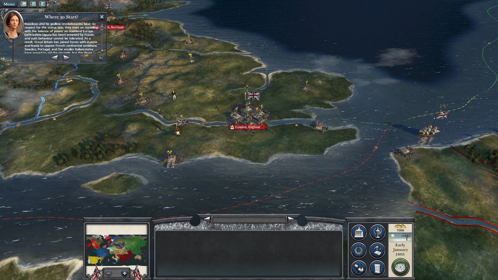
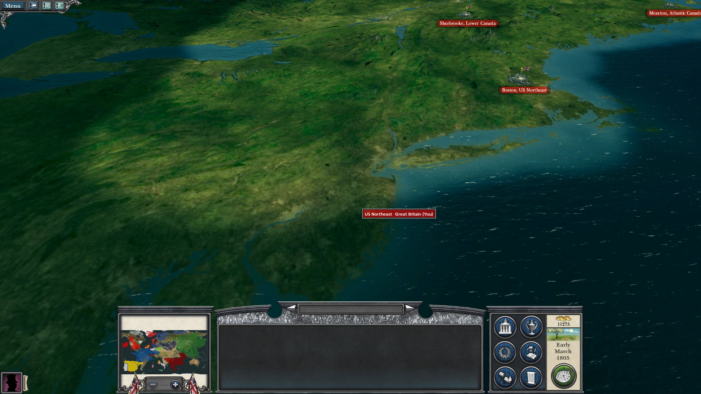
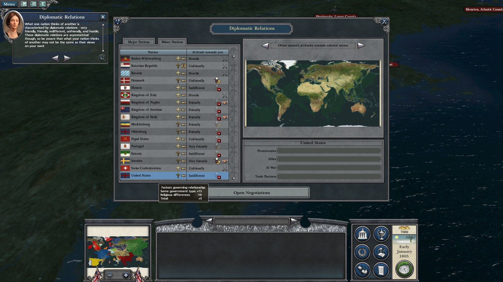
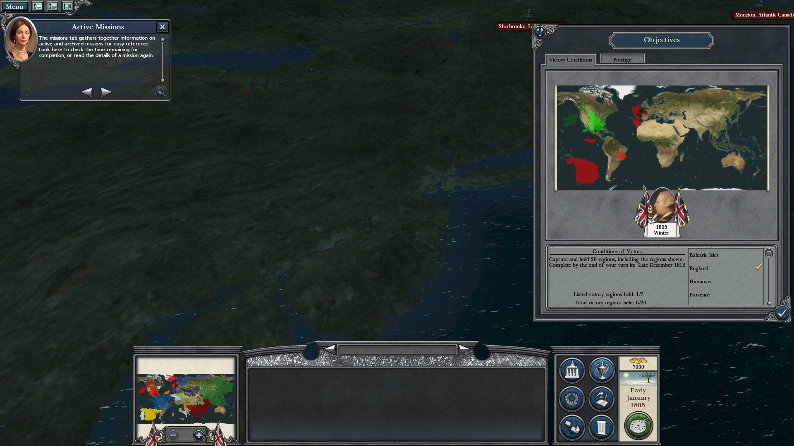
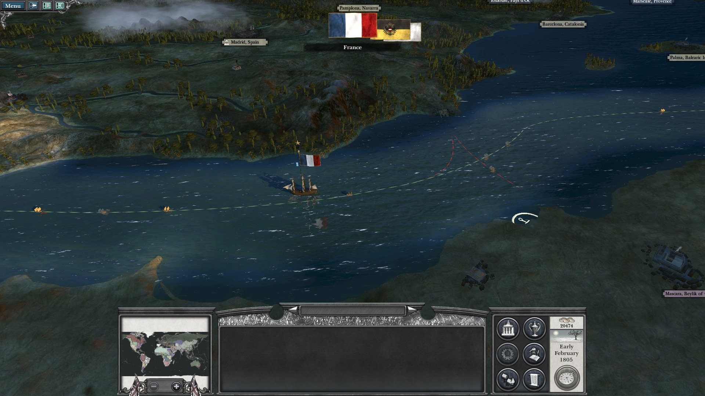
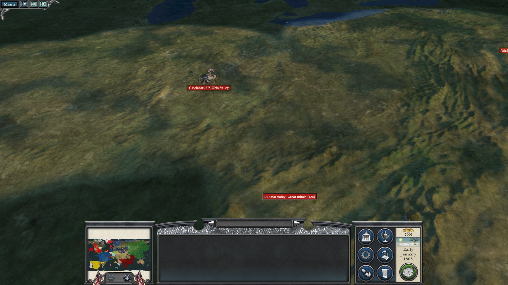

# Napoleon: Orbis

**The whole world as one campaign map for Napoleon: Total War.** Unofficial, free, and currently in beta.



Napoleon: Orbis replaces the Campaigns of the Coalition map with a single map of the Earth in 1805. It has 359 regions, dozens of new nations, and terrain built from real elevation and satellite data. Europe keeps its familiar start, with the rest of the world around it.

## Screenshots

*From test builds, so some names and borders differ from the current release.*

| | |
|---|---|
|  |  |
| Britain and France at the start | New England in spring |
|  |  |
| Diplomacy with the United States | Objectives, with territory shown worldwide |
|  |  |
| A French frigate during the AI turn | The Ohio Valley around Cincinnati |

## Install

You need the Steam version of Napoleon: Total War. The installer needs about 1 GB of free space.

1. Download the Windows or Linux zip from the [latest release](https://github.com/iSkuffed/NapoleonOrbis/releases).
2. Close the game, unzip the download and run the installer.
3. Choose **1) Install**.
4. Start a new **Campaigns of the Coalition** campaign.

If the installer can't find the game, run it from a command prompt with the game's folder:

```
napoleon-orbis-installer-windows-amd64.exe install --game "C:\path\to\Napoleon Total War"
```

On Linux with Steam and Proton, run the game once first, then run `./napoleon-orbis-installer-linux-amd64 install`.

Windows may warn that the installer comes from an unknown publisher because it isn't signed. Choose **More info**, then **Run anyway**.

### What the installer changes

- Adds the mod pack and a names pack to the game's `data` folder.
- Replaces the Coalition campaign's start file and keeps a backup of the original.
- Adds one line to `user.script.txt`.
- Patches `Napoleon.exe` so the larger map works, keeping the original as `Napoleon.exe.gn_backup`.

It only patches the known Steam version of the game and refuses any other `Napoleon.exe`. After a game update or a Steam file verification, run Install again.

To uninstall, run the installer and choose **2) Uninstall**. Use the same Windows or Linux installer you installed with.

## Beta status

- **Testing:** so far on Linux with Proton, including the Windows installer running under Wine. It hasn't been tested on a Windows PC yet, so reports from Windows players are especially useful.
- **Playable nations:** the campaign menu offers its usual four. The new nations are AI-controlled.
- **Turn times:** AI turns take longer than in the normal game, about 1 to 4 minutes per round in testing.
- **New nations' units:** they reuse existing game models and icons rather than having their own.
- **Small islands:** many are left out because they're too small for the map to represent. These include the Antilles, the Canaries and Hawaii.

Please report bugs in [Issues](https://github.com/iSkuffed/NapoleonOrbis/issues).

## Building from source

The release is built from your own copy of the game's files, so a checkout alone can't produce one. The tools are in `tools/`, the installer is in `installer/`, and `research/` and `RoadMap.html` record how the game's formats and limits were worked out. `installer/release.sh WORLD VERSION` makes the release zips from a finished world build.

## Credits and licence

The map data comes from Natural Earth, NOAA ETOPO 2022, NASA Blue Marble Next Generation and RESOLVE Ecoregions 2017. See [installer/CREDITS.txt](installer/CREDITS.txt) for the required credits.

The code is licensed under the [GNU General Public License v3.0](LICENSE). `tools/schemas/schema_nap.ron` comes from [rpfm-schemas](https://github.com/Frodo45127/rpfm-schemas) (MIT).

Napoleon: Total War is © The Creative Assembly / SEGA. This project isn't affiliated with or endorsed by them, and the GPL doesn't cover the game or its data.
